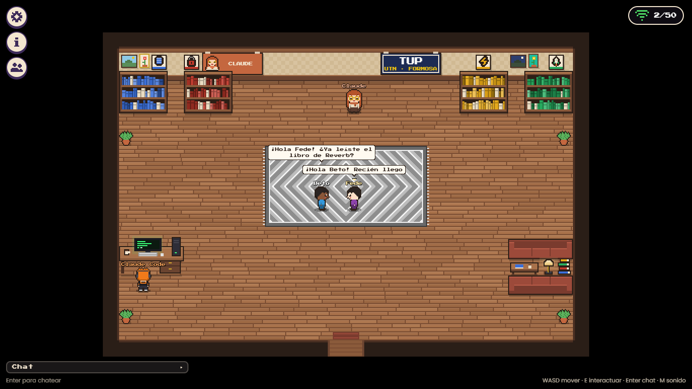
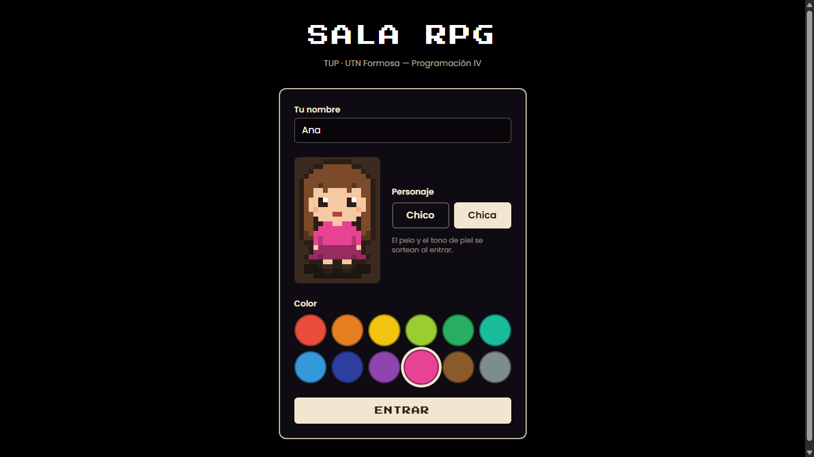
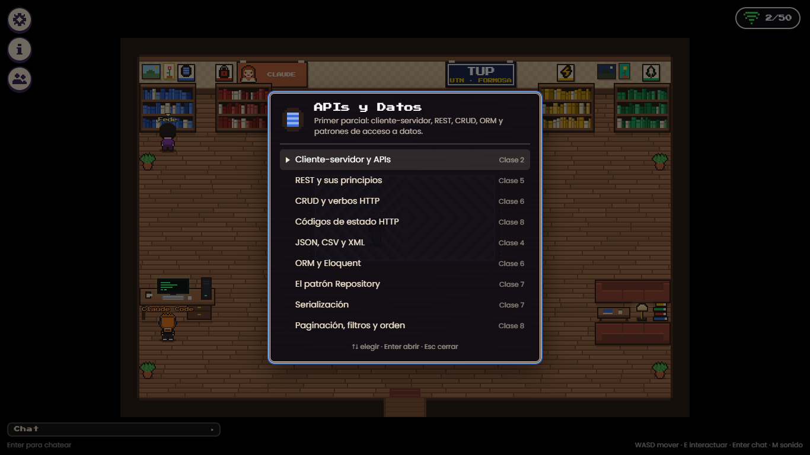
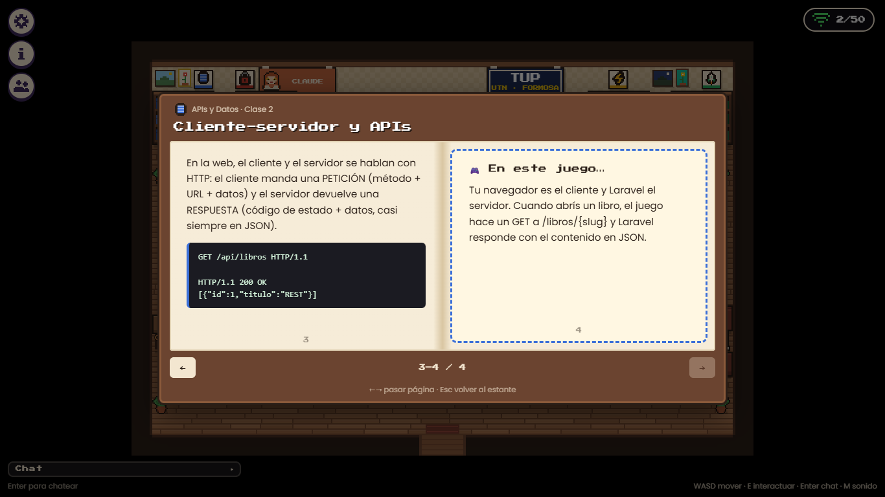
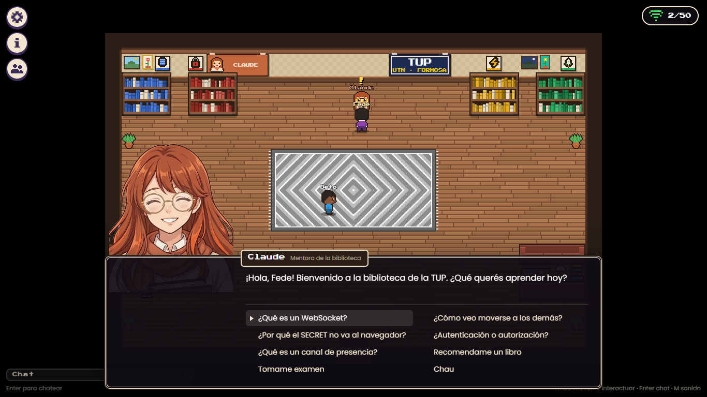
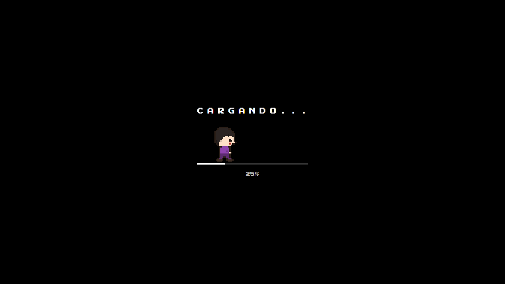

# Sala RPG

**Trabajo de Programación IV — TUP · UTN Formosa**

Un mini RPG multijugador en tiempo real, estilo pixel art. Hasta 50 personas entran con su nombre, eligen personaje y color, y comparten dos salas: una biblioteca y, bajando por su puerta, una arena. En la biblioteca:

- se ven moverse en vivo y chatean con globos de texto sobre la cabeza,
- leen **35 libros** con la teoría de la materia, repartidos en 4 estantes,
- charlan con dos NPCs: **Claude**, la mentora de la biblioteca (explica, recomienda libros y toma examen), y **Claude Code**, el programador (tips y comandos de `artisan`).

En la arena se retan a **duelos con espadas** en tiempo real (3 ❤️, 60 segundos) y un cartel muestra el **ranking** de victorias.

El juego es en sí mismo un ejemplo funcionando del programa: cada libro termina con una página **"🎮 En este juego…"** que señala dónde (o por qué no) se aplica ese concepto en este mismo código.



| Inicio | Biblioteca | Libro |
|---|---|---|
|  |  |  |

| Charla con Claude | Modo examen | Pantalla de carga |
|---|---|---|
|  |  |  |

---

## Tecnologías

- **Laravel 13** (PHP 8.4) + **MySQL** (XAMPP)
- **Laravel Reverb** (servidor WebSocket) + **Laravel Echo** y **pusher-js** en el navegador
- **Vite 8**, **Tailwind 4** (solo en la pantalla de inicio)
- **JavaScript sin frameworks** + **Canvas 2D**: el mapa, los muebles, los personajes y los íconos se dibujan por código desde matrices de píxeles; no hay imágenes salvo los retratos de los NPCs
- **WebAudio** para los sonidos (también generados por código)
- **PHPUnit 12** para los tests

## Instalación (Windows + XAMPP)

Requisitos: XAMPP (PHP 8.4 y MySQL), Composer, Node.js 20.19 o 22.12 en adelante (lo pide Vite 8) y Git Bash.

```bash
# 1. Dependencias
composer install
npm install

# 2. Configuración
cp .env.example .env
php artisan key:generate
```

En el `.env`, completá `REVERB_APP_ID` (un número cualquiera), y `REVERB_APP_KEY` y `REVERB_APP_SECRET` con textos al azar:

```bash
php -r "echo bin2hex(random_bytes(10));"
```

```bash
# 3. Base de datos: prendé MySQL en el panel de XAMPP y creá la base
"C:/xampp/mysql/bin/mysql.exe" -uroot -e "CREATE DATABASE sala_rpg CHARACTER SET utf8mb4 COLLATE utf8mb4_unicode_ci"

# 4. Tablas + contenido (4 estantes, 35 libros, 50 preguntas)
php artisan migrate --seed
```

### Para jugar: tres terminales

```bash
php artisan serve          # la app      → http://localhost:8000
php artisan reverb:start   # el WebSocket (puerto 8080)
npm run dev                # Vite (assets y fuentes)
```

Para probar el multijugador, abrí `http://localhost:8000` en un navegador normal y en una ventana de incógnito y entrá con dos nombres distintos.

> Si cambiás algo del `.env` que empieza con `VITE_`, reiniciá `npm run dev`: Vite lee esas variables solo al arrancar.

### Publicar para la clase

Para que los compañeros entren desde sus casas: Apache de XAMPP + Cloudflare Tunnel, con un solo comando (`./publicar.sh`). La guía completa está en **[PUBLICAR.md](PUBLICAR.md)**.

## Controles

| Tecla | Acción |
|---|---|
| WASD / flechas | Caminar |
| E / Espacio | Interactuar con lo que tenés enfrente: estantes, NPCs, el escritorio |
| Enter | Abrir el chat / enviar · Esc cancela |
| ↑ ↓ + Enter | Elegir en menús, diálogos y en el examen |
| ← → | Pasar las páginas de un libro |
| Esc | Cerrar el libro, el diálogo o el panel |
| M | Sonido sí / no |

Arriba a la izquierda están **⚙ Ajustes** (volumen, nombres sobre los personajes, tamaño del texto y salir), **ℹ Info** y **👥 Jugadores**.

### En el celular

- **Controles en pantalla** (solo en pantallas táctiles): d-pad abajo a la izquierda (si lo mantenés apretado seguís caminando), **A** = tecla E (interactuar y confirmar) y **💬** para el chat, uno al lado del otro. Las ventanas se cierran con su ✕.
- **Cámara:** si el mapa entero no entra con el pixel art a 2 px por píxel, se muestra solo una parte, centrada en tu personaje y sin salirse de los bordes. Funciona en vertical y en horizontal.
- Libros (◀ ▶ y ✕), menús de los estantes, diálogos y examen se usan tocando: nada depende solo del teclado.
- El campo del chat se acomoda arriba del teclado del celular, y el sonido se activa con el primer toque (como pide iOS).

## Arquitectura

```
Navegador ──HTTP (login, chat, libros, examen, guardar posición)──► Laravel
    ▲                                                                  │ broadcast firmado con el SECRET
    │ WebSocket (Echo + pusher-js)                                     ▼
    └──────────────────────────────── Reverb :8080 ◄───────────────────┘
          un canal de presencia por sala: sala.1 (biblioteca) y arena.1 (arena)
          • here / joining / leaving  → quién está
          • whisper 'mover'           → cada paso (navegador → Reverb → los demás, sin Laravel)
          • whisper 'estoy'           → tu posición actual, para el que acaba de entrar
          • evento .MensajeEnviado    → el chat (pasa por Laravel: validación + rate limit)
```

**La decisión clave: movimiento por whisper, chat por Laravel.** Con 50 jugadores caminando a 8 pasos por segundo, mandar cada paso por HTTP serían cientos de requests por segundo, y `php artisan serve` atiende de a uno. Por eso el movimiento va por *whisper*: rápido, sin pasar por Laravel, con datos efímeros. El chat, en cambio, necesita validación, límite de mensajes y quedar guardado, así que va por `POST /chat`. Es el trade-off *server-authoritative* contra *client events*.

Algunos detalles que hacen que funcione bien:

- **El que entra tarde:** `here()` trae la posición que cada uno tenía *cuando se unió*. Por eso, cuando alguien entra, cada jugador presente le responde con un whisper `estoy` con su posición actual.
- **Recargar sin perder el lugar:** la posición propia se guarda en la base cada 5 s (si cambió) y al cerrar la pestaña con `navigator.sendBeacon`.
- **Whispers que no se pueden falsificar del todo:** los whispers no pasan por Laravel, así que el juego no confía en el `id` que manda el cliente. Usa el `user_id` que Reverb agrega a partir de la sesión autenticada, y descarta posiciones fuera del mapa.
- **Reconexión:** si se corta el WebSocket, pusher-js reconecta solo. El ícono de wifi lo muestra (verde = conectado, amarillo = reconectando, rojo = sin conexión) y, al volver, se re-sincronizan las posiciones y el chat.
- **Duelos con árbitro en el servidor:** moverse y la animación de la espada van por whisper (los decide el navegador), pero cada golpe es un `POST` que `DueloService` valida dentro de una transacción con `lockForUpdate()`: duelo activo, que seas parte (`DueloPolicy`), cooldown (429), invulnerabilidad y vidas. El final también lo decide el servidor: por vidas, por tiempo (mira su propio reloj) o por abandono (le pregunta a Reverb si el rival de verdad se fue). Cada duelo queda guardado en la tabla `duelos`.
- **Varias salas, cada mapa en un solo lugar:** `resources/js/juego/data/salas/biblioteca.json` y `arena.json` los lee el JS para dibujar y calcular colisiones, y PHP (`SalaService`) para validar `POST /posicion`. Al cruzar una puerta, el juego guarda la sala nueva, deja el canal viejo y se une al nuevo sin cortar el WebSocket; `routes/channels.php` solo te deja entrar al canal de la sala donde estás.

### Rutas

| Método | URL | Qué hace |
|---|---|---|
| GET | `/` | Pantalla de inicio (si ya entraste, te lleva a `/sala`) |
| POST | `/entrar` | Valida nombre, personaje y color, crea el jugador e inicia sesión (máx. 10 por minuto) |
| POST | `/salir` | Cierra la sesión |
| GET | `/sala` | El juego |
| POST | `/posicion` | Guarda sala, x, y y dirección; rechaza celdas no caminables de esa sala (204) |
| GET / POST | `/chat` | Últimos 30 mensajes / enviar uno (201, máx. 10 por minuto por jugador → 429) |
| GET | `/biblioteca` | Estantes con los títulos de sus libros (sin páginas) |
| GET | `/libros/{slug}` | Un libro completo (404 si no existe) |
| GET | `/examen` | 5 preguntas al azar con las opciones mezcladas |
| POST | `/duelos` | Retar a otro jugador de la arena (le llega por su canal privado) |
| POST | `/duelos/{duelo}/aceptar` · `/rechazar` | Contestar el reto (solo el retado) |
| POST | `/duelos/{duelo}/golpe` | Un espadazo (validado por el servidor; 429 si es muy rápido) |
| POST | `/duelos/{duelo}/finalizar` | Cerrar el duelo cuando se acabaron los 60 s (422 si todavía no) |
| POST | `/duelos/{duelo}/abandono` | El rival se desconectó: el servidor lo confirma con Reverb y te da la victoria |
| GET | `/duelos/en-curso` | El duelo que se está peleando (para el que entra a la arena tarde) |
| GET | `/duelos/ranking` | Top 10 de victorias (consulta agrupada con `groupBy` + `COUNT`) |

## La materia dentro del juego

| Tema | Dónde está |
|---|---|
| Cliente-servidor, REST, códigos HTTP | Las rutas de arriba; 201, 204, 404, 419, 422 y 429 de verdad |
| Eloquent y relaciones | `Estante hasMany Libro`, `Pregunta belongsTo Libro` (por slug), `with()` para evitar N+1 |
| Capas | Controladores flacos, Form Requests (`EntrarRequest`, `ChatRequest`, `PosicionRequest`), servicios (`SalaService`, `ExamenService`) y API Resources |
| Validación y seguridad | Validación en el servidor, CSRF, `session()->regenerate()`, `textContent` en vez de `innerHTML` (anti-XSS), `@json` en Blade |
| Rate limiting y logging | Limitador `chat` (10/min) con `Log::warning`; `Log::info` al entrar y salir |
| Eventos y broadcasting | `MensajeEnviado implements ShouldBroadcast`, `broadcastAs()`, `toOthers()` |
| Canales | Un canal de presencia por sala (`sala.1`, `arena.1`) autorizado en `routes/channels.php` |
| Whispers y sincronización | `mover` y `estoy`, cola de pasos con interpolación y teletransporte si hay lag |
| Testing | 108 tests de feature, en SQLite y en MySQL (ver abajo) |

## Estructura

```
app/
  Events/MensajeEnviado.php
  Http/Controllers/       Inicio, Sala, Posicion, Chat, Biblioteca, Examen
  Http/Requests/          EntrarRequest, ChatRequest, PosicionRequest
  Http/Resources/         MensajeResource, EstanteResource, LibroResource
  Models/                 User, Estante, Libro, Mensaje, Pregunta
  Services/               SalaService, ExamenService, DueloService, PresenciaService
database/seeders/         BibliotecaSeeder, ExamenSeeder (+ data/libros.json y examen.json)
resources/js/juego/
  main.js                 arranque, carga y bucle del juego
  mapa.js                 salas (clase Mapa) y colisiones
  mapa-dibujo.js, arena-dibujo.js   arte de la biblioteca y de la arena
  pixel.js, sprites.js    pixel art desde matrices; personajes (chico/chica × color × 4 dir × 3 frames)
  npcs.js, conversacion.js, examen.js
  red.js, multijugador.js Echo, presencia y whispers
  duelos.js               retos, combate, reloj y final de los duelos (lado cliente)
  ui/                     carga, hud, chat, globo, estante, libro, dialogo, paneles, tactil
  data/                   salas/biblioteca.json, salas/arena.json, dialogos.json, diario.json
kit/                      fuente del contenido (libros, diálogos, examen, retratos)
```

## Tests

Hay dos formas de correrlos:

```bash
php artisan test        # rápido: SQLite en memoria
composer test:mysql     # igual que en producción: MySQL, en una base APARTE (sala_rpg_test)
```

- **SQLite** (`phpunit.xml`) es lo más rápido para el día a día.
- **MySQL** (`phpunit.mysql.xml`) encuentra lo que SQLite deja pasar. En este proyecto ya aparecieron dos bugs que solo existían en MySQL: una columna `VARCHAR(6)` donde no entraba `"izquierda"` (SQLite no controla el largo de los textos) y un `TIMESTAMP` al que MySQL le agregó solo `ON UPDATE CURRENT_TIMESTAMP`. `composer test:mysql` crea la base `sala_rpg_test` si no existe (`php artisan db:crear-test`) y corre todo ahí. Necesita MySQL prendido en XAMPP. (Llama a `vendor/bin/phpunit` y no a `php artisan test` porque artisan ya le pasa su propio `--configuration=phpunit.xml` y PHPUnit 12 termina con error si recibe dos.)
- **La base del juego nunca se toca**: los tests vacían su base en cada test (`RefreshDatabase`), por eso `tests/TestCase.php` tiene un seguro que se niega a correr contra cualquier base MySQL que no se llame `sala_rpg_test`.

Son 108 tests. Cubren:

- no se puede ver `/sala` sin login;
- `/entrar` valida nombre, personaje y color;
- `/chat` rechaza mensajes vacíos o de más de 80 caracteres (422) y el mensaje 11 en un minuto da 429;
- `/chat` emite `MensajeEnviado` (`Event::fake`) y no se cae si Reverb está apagado;
- `/posicion` rechaza celdas no caminables;
- `/libros/{slug}` da 404 si el libro no existe;
- los seeders cargan 4 estantes, 35 libros y 50 preguntas y se pueden correr varias veces;
- el canal de presencia firma solo los datos públicos (nunca el email);
- al mezclar las opciones del examen, la respuesta correcta sigue siendo la misma;
- los mapas de las salas son consistentes: miden lo mismo, desde la entrada se llega a todas las celdas caminables y cada puerta lleva a una celda caminable de la otra sala;
- solo se entra al canal de la sala donde estás.
- duelos: solo se reta en la arena, a otro y si ninguno está ocupado; solo el retado contesta; una invitación vencida no se acepta;
- combate: no se puede golpear fuera de un duelo, ni a uno mismo, ni antes del ¡YA!, ni más rápido que el cooldown (600 ms), ni a un rival invulnerable (800 ms), ni en un duelo terminado; el duelo termina al llegar a 0 ❤️; los milisegundos se guardan de verdad en la base.
- final: gana el que tiene más ❤️ a los 60 s (o empate), no se puede cerrar antes de tiempo, el abandono solo cuenta si Reverb confirma que el rival se fue, y un duelo olvidado se cierra solo;
- ranking: ordena por victorias (desempata el que llegó antes), no cuenta empates ni duelos sin terminar y muestra solo el top 10.

## Decisiones y límites conocidos

- **El examen es de práctica.** La respuesta correcta viaja al navegador (con F12 se ve). Para un examen con nota habría que corregir en el servidor y no mandarla nunca.
- **Opciones mezcladas.** En `examen.json` la correcta era la segunda opción en 33 de 50 preguntas; el servidor mezcla las opciones en cada examen para que no se pueda adivinar por la posición.
- **Login solo con nombre.** No hay contraseñas: es una sala para una clase. Los nombres pueden repetirse y, si cerrás sesión, la próxima vez sos un jugador nuevo.
- **Cupo:** si además de vos ya hay 50 personas, aparece "Sala llena (50/50)". Reverb acepta como máximo 60 conexiones.
- **Columna `dir`:** el diseño original la definía de 6 caracteres, pero `"izquierda"` tiene 9. Una migración aparte la amplía; los tests no lo detectaban porque SQLite no controla el largo de los textos.

## Créditos

Proyecto de Programación IV — TUP UTN Formosa.

Mapa, muebles, personajes, íconos y sonidos: generados por código. Retratos de los NPCs: ilustraciones generadas con Gemini, recortadas y alineadas para el juego (`kit/retratos`). Fuentes: [Poppins](https://fonts.google.com/specimen/Poppins) y [Press Start 2P](https://fonts.google.com/specimen/Press+Start+2P), con licencia OFL.
